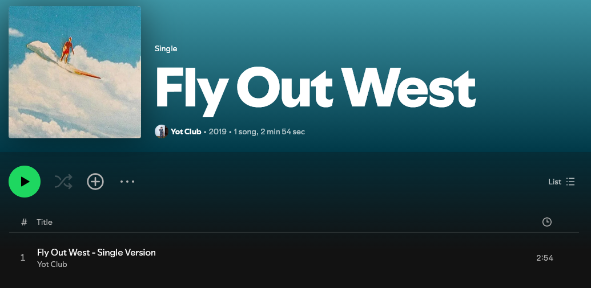
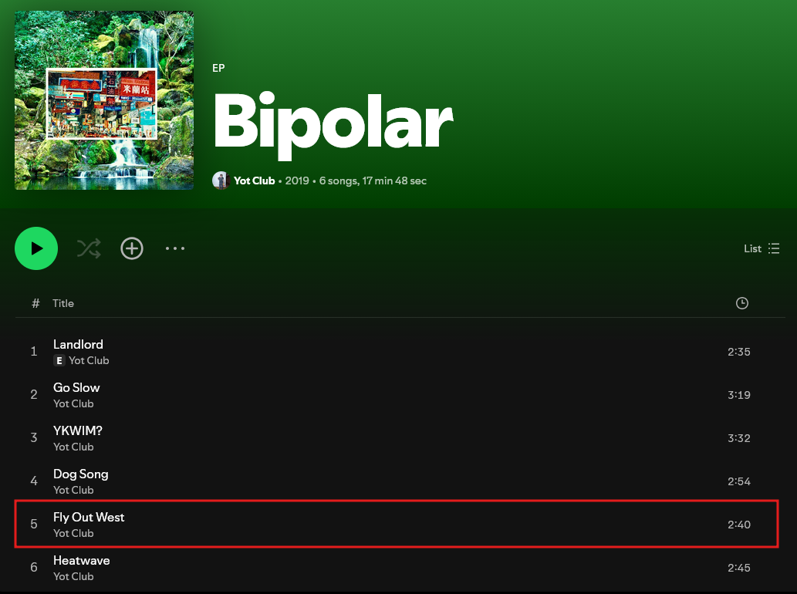
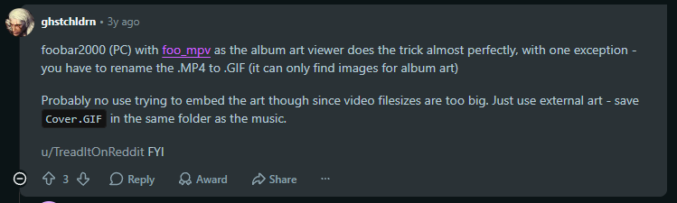
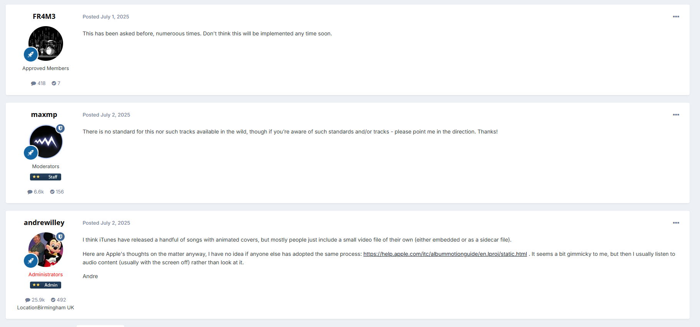
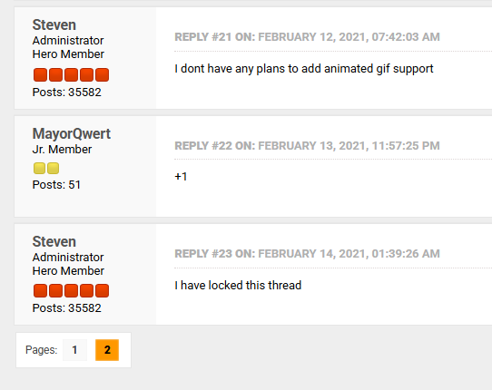

# Обложки, сканы, буклеты

## Типы и форматы обложек

Для встраивания обложек в треки я использую Mp3tag со следующими параметрами:

- Формат: `JPEG`;
- Разрешение: 1200x1200 (максимальное). Масштабировать пропорционально;
- Качество: высокое (80).

Встраивается только одна обложка - Front Cover.

---

Для остальных типов обложек используется формат `PNG`, если они доступны в этом формате, в ином случае `JPEG`. Конвертация из `JPEG` в `PNG` не допускается.  
Я использую утилиту [oxipng](https://github.com/oxipng/oxipng) для эффективного сжатия без потерь файлов в формате `PNG`, уровень оптимизации: 2 (по умолчанию). Таким образом обложки весят на 10-25% меньше.

Внешняя обложка релиза имеет название `cover` и находится рядом с аудиофайлами.

## Сканнинг

> [!TIP]
> О типах обложек и сканов можно ознакомиться в [документации MusicBrainz](https://musicbrainz.org/doc/Cover_Art/Types).  
> О процессе сканирования обложек можно прочитать в [MusicHoarders вики](https://musichoarders.xyz/guides/scanning-media/).  
> О правилах наименования сканов можно прочитать [там же](https://musichoarders.xyz/reference/naming-scans/), однако я записываю все имена сканов и других обложек строчными буквами.

Для сканирования обложек с физических релизов я использую HP LaserJet Professional M1132 MFP (Contact Image Sensor сканер).  
Сканирование выполняется с разрешением 600 dpi.

Отсканированные обложки находятся в директории `scans`, даже если скан был произведен не мной.

> [!WARNING]
> Отсканированные обложки будут находиться в директории `other materials`, если релиз является цифровым, а обложки были взяты с его физической версии.

## Дополнительные обложки

Дополнительные обложки включают в себя альтернативные обложки сингла/альбома, невыпущенные материалы, постеры и так далее.  
Буклеты не относятся к категории дополнительных обложек, о них написано в следующем разделе.  
Возьмем следующий пример:

1. В 2019 году выходит сингл Fly Out West, он имеет следующую обложку:

2. Позже, в том же году выходит альбом Bipolar, в котором эта песня находится на 5 месте и использует обложку альбома:

3. Таким образом обложка сингла теряется, что не есть хорошо, поэтому я ее сохраняю отдельно.

Дополнительные обложки могут браться и из других мест, например, из невыпущенных материалов или видео.  
Забавный пример можно посмотреть в этом [посте на Reddit](https://www.reddit.com/r/lanadelrey/comments/14x4amo/did_you_know_that_theres_a_tunnel_under_ocean/), у этого альбома целых 6 обложек!

---

Дополнительные обложки находятся в директории `other materials`.

Наименование альтернативных обложек треков: `cover <Номер диска>.<Номер трека с ведущим нулем>`.  
Например: `cover 1.03`, `cover 1.09`.

Наименование альтернативных обложек релизов: `cover <Номер обложки>`.  
Например: `cover 3` означает третью альтернативную обложку альбома.

Другие наименования обложек: `video background`, `poster`.  

## Буклеты

> [!WARNING]
> Буклеты хранятся:  
>
> - в директории `scans`, если релиз физический и буклет отсканирован непосредственно с него;  
> - в директории `other materials`, если релиз цифровой и/или буклет был взят из стороннего источника.

Буклет не обязательно должен принадлежать конкретному релизу.  
Например: у цифрового релиза может быть буклет, полученный с компакт-диска; у релиза, выпущенного в Великобритании может быть буклет японской версии.

Наименование для страниц буклета: `booklet page <Номер скана с ведущим нулем>`.  
Например: `booklet page 01`, `booklet page 12`.

Примеры других наименований, связанных с буклетом: `booklet outside`, `booklet inside`, `booklet lyrics page 02`.

## Анимированные обложки

Я не использую и не сохраняю анимированные обложки по следующим причинам:

1. Множество анимированных обложек это просто пульсация статичной картинки, что выглядит довольно странным по моему мнению;
2. Они занимают довольно много места;
3. Встраивание и отображение анимированных обложек различается в разных форматах тегов и музыкальных плеерах;
4. По состоянию на октябрь 2026 года, анимированные обложки не поддерживаются нативно почти что нигде, а именно:  
  **foobar2000** - нативно не поддерживается, нужен плагин ([обсуждение №1](https://www.reddit.com/r/musichoarder/comments/1aeucbn/comment/koa83a9/), [обсуждение №2](https://www.reddit.com/r/foobar2000/comments/1dpgijy/does_animated_cover_art_work/)):
  
  **Poweramp** - не поддерживается ([обсуждение](https://forum.powerampapp.com/topic/29600-animated-song-cover/)):
  
  **MusicBee** - не поддерживается и не планируется ([обсуждение](https://getmusicbee.com/forum/index.php?topic=370.msg187355#msg187355)):
  
