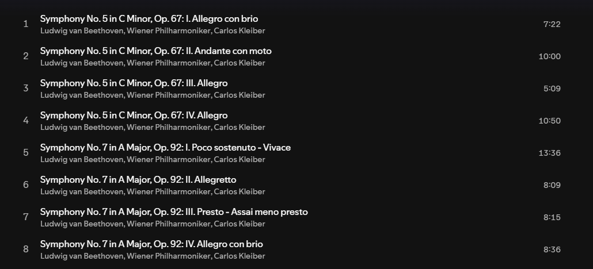

<!-- markdownlint-disable MD028 MD033 -->

# Теги

> [!CAUTION]
> Этот раздел описывает то, как именно я теггирую аудиофайлы. Информация, содержащаяся здесь, может иметь определенные недостатки, не совпадать с мнением других людей, отличаться от рекомендаций в руководствах и вики, не следовать лучшим практикам теггирования.  
> Я буду исходить из своего опыта и опыта других для разъяснения различных спорных моментов и компромиссных решений.

> [!WARNING]
> Названия тегов в этом разделе приведены как обобщенные понятия. Конкретные имена полей зависят от формата метаданных (подробнее смотрите в таблицах сопоставления тегов).  
> Например, `Album Artist` соответствует полю `ALBUMARTIST` в **Vorbis Comment**, атому `aART` в **iTunes MP4** и `TPE2` фрейму в **ID3v2**.

## Разделение по группам

**Основные теги** - теги, которые обязательны для заполнения при наличии соответствующих данных.

**Расширенные теги** - теги, которые предоставляют дополнительную информацию о релизе. Являются необязательными, но довольно полезны для группировки или сортировки библиотеки по определенным критериям.

**Специализированные теги** - теги, которые в первую очередь, содержат служебные и идентификационные данные. Некоторые используются только в случае необходимости. Множество из них автоматически заполняются теггерами (например, MusicBrainz Picard). Являются необязательными, но могут быть полезны в определенных случаях.

**Исключенные теги** - теги, которые я не использую по какой-то из этих причин:

- Они содержат информацию, которая имеет смысл только для одного человека (например, личные сведения о прослушивании и рейтинги);
- Они содержат информацию, которая имеет низкую практическую ценность либо не может служить достоверным доказательством происхождения файла;
- Они дублируют или частично дублируют информацию, которая уже хранится в других тегах;
- Они содержат неинтересующую меня информацию.

Для Расширенных и Специализированных тегов я также указываю в таблицах сопоставления тегов, поддерживаются ли они в музыкальных плеерах, которые я использую.

> [!WARNING]
> В таблицах сопоставления тегов зафиксированы правила, используемые в этой библиотеке. Некоторые поля используют нативные фреймы или атомы конкретных форматов, в то время как другие являются пользовательскими метаданными (например, атомы, начинающиеся с `----`, в формате **iTunes MP4**).  
> Данные правила не следует рассматривать как универсальный стандарт маппинга для всех программ теггирования.  

> [!NOTE]
> Таблицы сопоставления тегов, на которые я ссылался:
>
> - [HydrogenAudio Tag Mapping Tables](https://wiki.hydrogenaudio.org/index.php?title=Tag_Mapping),
> - [Mp3tag Tag Field Mappings](https://docs.mp3tag.de/mapping/),
> - [MusicBrainz Picard Tag Mapping Table](https://picard-docs.musicbrainz.org/en/latest/_static/MusicBrainz_Picard_Tag_Map.html),
> - [Foobar2000 Tag Mapping Table](https://wiki.hydrogenaudio.org/index.php?title=Foobar2000:ID3_Tag_Mapping).
>
> Консольные утилиты для проверки точных названий полей, фреймов и атомов в метаданных:
>
> - [exiftool](https://exiftool.org/) (все форматы),
> - [metaflac](https://xiph.org/flac/documentation_tools_metaflac.html) (FLAC),
> - [atomicparsley](https://github.com/wez/atomicparsley) (iTunes MP4).

## Основные теги

- `Title` - название трека.
- `Artist` - исполнитель или исполнители трека.
- `Album` - название конкретного издания релиза.
- `Album Artist` - исполнитель или исполнители релиза.
- `Date` - дата выхода конкретного издания релиза в `YYYY-MM-DD`, `YYYY-MM` или `YYYY` формате, в зависимости от того, что известно.
- `Track Number` - номер трека на носителе (без ведущего нуля).
- `Track Total` - общее количество треков на носителе (без ведущего нуля).
- `Disc Number` - номер носителя (без ведущего нуля).
- `Disc Total` - общее количество носителей в релизе (без ведущего нуля).
- `Cover` - встроенная обложка релиза. Подробнее об этом читайте в разделе [Обложки, сканы, буклеты](/ru-ru/covers-and-booklets/?id=Типы-и-форматы-обложек).

Таблица сопоставления Основных тегов:

<table>
  <thead>
    <tr>
      <th>Тег</th>
      <th>Тип<a href="#/ru-ru/tags/?id=note-1" id="ref-1">[1]</a></th>
      <th>Vorbis Comment</th>
      <th>iTunes MP4</th>
      <th>ID3v2.3</th>
      <th>ID3v2.4</th>
    </tr>
  </thead>
  <tbody>
    <tr>
      <td style="font-weight: bold">Title</td>
      <td>Однозначный</td>
      <td><code>TITLE</code></td>
      <td><code>©nam</code></td>
      <td colspan="2"><code>TIT2</code></td>
    </tr>
    <tr>
      <td style="font-weight: bold">Artist</td>
      <td style="white-space: nowrap">Многозначный<a href="#/ru-ru/tags/?id=note-2" id="ref-2">[2]</a></td>
      <td><code>ARTIST</code></td>
      <td><code>©ART</code></td>
      <td colspan="2"><code>TPE1</code></td>
    </tr>
    <tr>
      <td style="font-weight: bold">Album</td>
      <td>Однозначный</td>
      <td><code>ALBUM</code></td>
      <td><code>©alb</code></td>
      <td colspan="2"><code>TALB</code></td>
    </tr>
    <tr>
      <td style="font-weight: bold">Album Artist</td>
      <td>Однозначный</td>
      <td><code>ALBUMARTIST</code></td>
      <td><code>aART</code></td>
      <td colspan="2"><code>TPE2</code></td>
    </tr>
    <tr>
      <td style="font-weight: bold">Date</td>
      <td>Однозначный</td>
      <td><code>DATE</code></td>
      <td><code>©day</code></td>
      <td><code>TYER</code>+<code>TDAT</code><a href="#/ru-ru/tags/?id=note-3" id="ref-3">[3]</a></td>
      <td><code>TDRC</code></td>
    </tr>
    <tr>
      <td style="font-weight: bold">Track Number</td>
      <td>Однозначный</td>
      <td><code>TRACKNUMBER</code></td>
      <td rowspan="2"><code>trkn</code> (Track Number and Track Total)</td>
      <td rowspan="2" colspan="2"><code>TRCK</code> (Track Number/Track Total)</td>
    </tr>
    <tr>
      <td style="font-weight: bold">Track Total</td>
      <td>Однозначный</td>
      <td><code>TRACKTOTAL</code></td>
    </tr>
    <tr>
      <td style="font-weight: bold">Disc Number</td>
      <td>Однозначный</td>
      <td><code>DISCNUMBER</code></td>
      <td rowspan="2"><code>disk</code> (Disc Number and Disc Total)</td>
      <td rowspan="2" colspan="2"><code>TPOS</code> (Disc Number/Disc Total)</td>
    </tr>
    <tr>
      <td style="font-weight: bold">Disc Total</td>
      <td>Однозначный</td>
      <td><code>DISCTOTAL</code></td>
    </tr>
    <tr>
      <td style="font-weight: bold">Cover</td>
      <td>Картинка</td>
      <td>FLAC: блок метаданных Picture<a href="#/ru-ru/tags/?id=note-4" id="ref-4">[4]</a>
       Opus: METADATA_BLOCK_PICTURE<a href="#/ru-ru/tags/?id=note-5" id="ref-5">[5]</a></td>
      <td><code>covr</code></td>
      <td colspan="2"><code>APIC</code></td>
    </tr>
  </tbody>
</table>

## Расширенные теги

- `Genre` - жанры.<a href="#/ru-ru/tags/?id=note-6" id="ref-6">[6]</a>
- `Style` - поджанры.<a href="#/ru-ru/tags/?id=note-6" id="ref-6-2">[6]</a>
- `Original Date` - дата выхода самого старого издания релиза (первого выпуска) в `YYYY-MM-DD`, `YYYY-MM` или `YYYY` формате, в зависимости от того, что известно.<a href="#/ru-ru/tags/?id=note-7" id="ref-7">[7]</a>
- `Arranger` - аранжировщик.
- `Composer` - композитор.
- `Producer` - продюсер.
- `Remixer` - автор или авторы ремикса трека.

Таблица сопоставления Расширенных тегов:

<table>
  <thead>
    <tr>
      <th>Тег</th>
      <th>Тип<a href="#/ru-ru/tags/?id=note-1" id="ref-1-2">[1]</a></th>
      <th>Поддержка в Poweramp</th>
      <th>Поддержка в foobar2000</th>
      <th>Vorbis Comment</th>
      <th>iTunes MP4</th>
      <th>ID3v2.3</th>
      <th>ID3v2.4</th>
    </tr>
  </thead>
  <tbody>
    <tr>
      <td style="font-weight: bold">Genre</td>
      <td>Многозначный</td>
      <td>Есть</td>
      <td>Нативная</td>
      <td><code>GENRE</code></td>
      <td><code>©gen</code></td>
      <td colspan="2"><code>TCON</code></td>
    </tr>
    <tr>
      <td style="font-weight: bold">Style</td>
      <td>Многозначный</td>
      <td>Нет</td>
      <td>Можно настроить</td>
      <td><code>STYLE</code></td>
      <td><code>----:com.apple.iTunes:STYLE</code></td>
      <td colspan="2"><code>TXXX:STYLE</code></td>
    </tr>
    <tr>
      <td style="font-weight: bold">Original Date</td>
      <td>Однозначный</td>
      <td>Нет<a href="#/ru-ru/tags/?id=note-8" id="ref-8">[8]</a></td>
      <td>Можно настроить</td>
      <td><code>ORIGINALDATE</code></td>
      <td><code>----:com.apple.iTunes:ORIGINALDATE</code></td>
      <td><code>TORY</code><a href="#/ru-ru/tags/?id=note-9" id="ref-9">[9]</a></td>
      <td><code>TDOR</code></td>
    </tr>
    <tr>
      <td style="font-weight: bold">Arranger</td>
      <td>Многозначный</td>
      <td>Нет</td>
      <td>Можно настроить</td>
      <td><code>ARRANGER</code></td>
      <td><code>©arg</code></td>
      <td colspan="2"><code>TXXX:ARRANGER</code></td>
    </tr>
    <tr>
      <td style="font-weight: bold">Composer</td>
      <td>Многозначный</td>
      <td>Есть</td>
      <td>Нативная</td>
      <td><code>COMPOSER</code></td>
      <td><code>©wrt</code></td>
      <td colspan="2"><code>TCOM</code></td>
    </tr>
    <tr>
      <td style="font-weight: bold">Producer</td>
      <td>Многозначный</td>
      <td>Нет<a href="#/ru-ru/tags/?id=note-10" id="ref-10">[10]</a></td>
      <td>Можно настроить</td>
      <td><code>PRODUCER</code></td>
      <td><code>©prd</code></td>
      <td colspan="2"><code>TXXX:PRODUCER</code></td>
    </tr>
    <tr>
      <td style="font-weight: bold">Remixer</td>
      <td>Многозначный</td>
      <td>Нет</td>
      <td>Можно настроить</td>
      <td><code>REMIXER</code></td>
      <td><code>----:com.apple.iTunes:REMIXER</code></td>
      <td colspan="2"><code>TPE4</code></td>
    </tr>
  </tbody>
</table>

## Специализированные теги

- `BPM` - количество ударов в минуту.
- `Album Artist Sort` - тег, используемый для сортировки исполнителя или исполнителей релиза.<a href="#/ru-ru/tags/?id=note-11" id="ref-11">[11]</a>
- `Artist Sort` - аналогичен тегу `Album Artist Sort`, но используется для сортировки исполнителя или исполнителей трека.<a href="#/ru-ru/tags/?id=note-11" id="ref-11-2">[11]</a>
- `Composer Sort` - аналогичен тегам `Album Artist Sort` и `Artist Sort`, но используется для сортировки композитора или композиторов.<a href="#/ru-ru/tags/?id=note-11" id="ref-11-3">[11]</a>
- `Barcode` - штрихкод музыкального релиза. Полезен для идентификации релиза в базах данных, цифровых магазинах, стриминговых сервисах.<a href="#/ru-ru/tags/?id=note-12" id="ref-12">[12]</a>
- `Catalog Number` - это каталожный номер (или номера), присвоенный релизу его лейблом (или лейблами). Полезен для идентификации релиза в каталоге лейбла, базах данных, цифровых магазинах, стриминговых сервисах.
- `ISRC` - уникальный международный код, который присваивается аудиозаписи. Полезен для идентификации конкретной аудиозаписи в базах данных, цифровых магазинах, потоковых сервисах.<a href="#/ru-ru/tags/?id=note-13" id="ref-13">[13]</a>
- `Label` (или `Publisher`) - лейбл или издатель.
- `Copyright` - информация об авторском праве на релиз.
- `Compilation` - флаг, который указывает, что трек является частью сборника (например, где исполнитель релиза это Various Artists).
- `Content Group` - тег, который обеспечивает дополнительный уровень группировки треков внутри релиза.<a href="#/ru-ru/tags/?id=note-14" id="ref-14">[14]</a>
- `Language` - язык или языки, на которых говорят или поют в треке (`eng`, `rus`, `jpn` и другие).<a href="#/ru-ru/tags/?id=note-15" id="ref-15">[15]</a>
- `Media` - источник релиза (`CD`, `WEB`, `SACD`, `Vinyl`, `Cassette` и другие).
- `Release Country` - страна или территория, где был издан релиз (`US`, `JP`, `GB`, `XW`).
- `MusicBrainz IDs` - уникальные идентификаторы из базы данных MusicBrainz<a href="#/ru-ru/tags/?id=note-16" id="ref-16">[16]</a>, а именно:
  - `MusicBrainz Artist ID` - тег, содержащий идентификаторы MBID для исполнителей трека;
  - `MusicBrainz Release Artist ID` - тег, содержащий идентификаторы MBID для исполнителей релиза;
  - `MusicBrainz Composer ID` - тег, содержащий идентификаторы MBID для композиторов;
  - `MusicBrainz Work ID` - тег, содержащий идентификаторы MBID для произведений, если существуют соответствующие произведения.
  - `MusicBrainz Track ID` - тег, содержащий идентификатор MBID для трека;
  - `MusicBrainz Recording ID` - тег, содержащий идентификатор MBID для записи;
  - `MusicBrainz Release ID` - тег, содержащий идентификатор MBID для релиза;
  - `MusicBrainz Release Group ID` - тег, содержащий идентификатор MBID для группы релизов;
- `ReplayGain Tags` - теги, которые отвечают за ReplayGain<a href="#/ru-ru/tags/?id=note-17" id="ref-17">[17]</a>, а именно:
  - `ReplayGain Track Gain` - тег, который содержит значение коррекции громкости (в дБ) для одного конкретного трека, чтобы он соответствовал уровню -18 LUFS<a href="#/ru-ru/tags/?id=note-18" id="ref-18">[18]</a> (или условному уровню 89 дБ SPL<a href="#/ru-ru/tags/?id=note-19" id="ref-19">[19]</a> в ReplayGain 1.0);
  - `ReplayGain Track Peak` - тег, который содержит максимальный пиковый уровень сигнала внутри одного трека. Позволяет музыкальному плееру ограничить усиление и предотвратить клиппинг, если усиление (`ReplayGain Track Gain`) приводит к превышению цифрового порога 0 dBFS<a href="#/ru-ru/tags/?id=note-20" id="ref-20">[20]</a>;
  - `ReplayGain Album Gain` - тег, который содержит значение коррекции громкости (в дБ) для всего альбома. Это выравнивает общий уровень альбома относительно -18 LUFS<a href="#/ru-ru/tags/?id=note-18" id="ref-18-2">[18]</a> (или относительно условного уровня 89 дБ SPL<a href="#/ru-ru/tags/?id=note-19" id="ref-19-2">[19]</a> в ReplayGain 1.0), при этом сохраняя контраст между тихими и громкими песнями внутри него;
  - `ReplayGain Album Peak` - тег, который содержит максимальный пиковый уровень сигнала среди всех треков альбома.

Таблица сопоставления Специализированных тегов:

<table>
  <thead>
    <tr>
      <th>Тег</th>
      <th>Тип<a href="#/ru-ru/tags/?id=note-1" id="ref-1-3">[1]</a></th>
      <th>Поддержка в Poweramp</th>
      <th>Поддержка в foobar2000</th>
      <th>Vorbis Comment</th>
      <th>iTunes MP4</th>
      <th>ID3v2.3</th>
      <th>ID3v2.4</th>
    </tr>
  </thead>
  <tbody>
    <tr>
      <td style="font-weight: bold">BPM</td>
      <td>Однозначный</td>
      <td>Нет<a href="#/ru-ru/tags/?id=note-21" id="ref-21">[21]</a></td>
      <td>Можно настроить</td>
      <td><code>BPM</code></td>
      <td><code>tmpo</code></td>
      <td colspan="2"><code>TBPM</code></td>
    </tr>
    <tr>
      <td style="font-weight: bold">Album Artist Sort</td>
      <td>Однозначный</td>
      <td>Нет<a href="#/ru-ru/tags/?id=note-22" id="ref-22">[22]</a>, но есть другие настройки</td>
      <td>Можно настроить</td>
      <td><code>ALBUMARTISTSORT</code></td>
      <td><code>soaa</code></td>
      <td colspan="2"><code>TSO2</code><a href="#/ru-ru/tags/?id=note-23" id="ref-23">[23]</a></td>
    </tr>
    <tr>
      <td style="font-weight: bold">Artist Sort</td>
      <td>Однозначный</td>
      <td>Нет<a href="#/ru-ru/tags/?id=note-22" id="ref-22-2">[22]</a>, но есть другие настройки</td>
      <td>Можно настроить</td>
      <td><code>ARTISTSORT</code></td>
      <td><code>soar</code></td>
      <td colspan="2"><code>TSOP</code><a href="#/ru-ru/tags/?id=note-23" id="ref-23-2">[23]</a></td>
    </tr>
    <tr>
      <td style="font-weight: bold">Composer Sort</td>
      <td>Однозначный</td>
      <td>Нет<a href="#/ru-ru/tags/?id=note-22" id="ref-22-3">[22]</a>, но есть другие настройки</td>
      <td>Можно настроить</td>
      <td><code>COMPOSERSORT</code></td>
      <td><code>soco</code></td>
      <td colspan="2"><code>TSOC</code><a href="#/ru-ru/tags/?id=note-23" id="ref-23-3">[23]</a></td>
    </tr>
    <tr>
      <td style="font-weight: bold">Barcode</td>
      <td>Многозначный</td>
      <td>Нет</td>
      <td>Можно настроить</td>
      <td><code>BARCODE</code></td>
      <td><code>----:com.apple.iTunes:BARCODE</code></td>
      <td colspan="2"><code>TXXX:BARCODE</code></td>
    </tr>
    <tr>
      <td style="font-weight: bold">Catalog Number</td>
      <td>Многозначный</td>
      <td>Нет</td>
      <td>Можно настроить</td>
      <td><code>CATALOGNUMBER</code></td>
      <td><code>----:com.apple.iTunes:CATALOGNUMBER</code></td>
      <td colspan="2"><code>TXXX:CATALOGNUMBER</code></td>
    </tr>
    <tr>
      <td style="font-weight: bold">ISRC</td>
      <td>Многозначный</td>
      <td>Нет</td>
      <td>Можно настроить</td>
      <td><code>ISRC</code></td>
      <td><code>----:com.apple.iTunes:ISRC</code></td>
      <td colspan="2"><code>TSRC</code></td>
    </tr>
    <tr>
      <td style="font-weight: bold">Label</td>
      <td>Многозначный</td>
      <td>Нет<a href="#/ru-ru/tags/?id=note-24" id="ref-24">[24]</a></td>
      <td>Можно настроить</td>
      <td><code>LABEL</code></td>
      <td><code>----:com.apple.iTunes:LABEL</code></td>
      <td colspan="2"><code>TPUB</code></td>
    </tr>
    <tr>
      <td style="font-weight: bold">Copyright</td>
      <td>Многозначный</td>
      <td>Нет</td>
      <td>Можно настроить</td>
      <td><code>COPYRIGHT</code></td>
      <td><code>cprt</code></td>
      <td colspan="2"><code>TCOP</code></td>
    </tr>
    <tr>
      <td style="font-weight: bold">Compilation</td>
      <td>Однозначный</td>
      <td>Нет<a href="#/ru-ru/tags/?id=note-25" id="ref-25">[25]</a></td>
      <td>Можно настроить</td>
      <td><code>COMPILATION</code></td>
      <td><code>cpil</code></td>
      <td colspan="2"><code>TCMP</code><a href="#/ru-ru/tags/?id=note-23" id="ref-23-4">[23]</a></td>
    </tr>
    <tr>
      <td style="font-weight: bold">Content Group</td>
      <td>Однозначный</td>
      <td>Нет<a href="#/ru-ru/tags/?id=note-26" id="ref-26">[26]</a></td>
      <td>Можно настроить</td>
      <td><code>CONTENTGROUP</code></td>
      <td><code>©grp</code></td>
      <td colspan="2"><code>TIT1</code></td>
    </tr>
    <tr>
      <td style="font-weight: bold">Language</td>
      <td>Многозначный</td>
      <td>Нет</td>
      <td>Можно настроить</td>
      <td><code>LANGUAGE</code></td>
      <td><code>----:com.apple.iTunes:LANGUAGE</code></td>
      <td colspan="2"><code>TLAN</code></td>
    </tr>
    <tr>
      <td style="font-weight: bold">Media</td>
      <td>Многозначный</td>
      <td>Нет</td>
      <td>Можно настроить</td>
      <td><code>MEDIA</code></td>
      <td><code>----:com.apple.iTunes:MEDIA</code></td>
      <td colspan="2"><code>TXXX:MEDIA</code></td>
    </tr>
    <tr>
      <td style="font-weight: bold">Release Country</td>
      <td>Многозначный</td>
      <td>Нет</td>
      <td>Можно настроить</td>
      <td><code>RELEASECOUNTRY</code></td>
      <td><code>----:com.apple.iTunes:RELEASECOUNTRY</code></td>
      <td colspan="2"><code>TXXX:RELEASECOUNTRY</code></td>
    </tr>
    <tr>
      <td style="font-weight: bold">MusicBrainz Artist ID</td>
      <td>Многозначный</td>
      <td>Нет</td>
      <td>Можно настроить</td>
      <td><code>MUSICBRAINZ_ARTISTID</code></td>
      <td><code>----:com.apple.iTunes:MusicBrainz Artist Id</code></td>
      <td colspan="2"><code>TXXX:MusicBrainz Artist Id</code></td>
    </tr>
    <tr>
      <td style="font-weight: bold">MusicBrainz Release Artist ID</td>
      <td>Многозначный</td>
      <td>Нет</td>
      <td>Можно настроить</td>
      <td><code>MUSICBRAINZ_ALBUMARTISTID</code></td>
      <td><code>----:com.apple.iTunes:MusicBrainz Album Artist Id</code></td>
      <td colspan="2"><code>TXXX:MusicBrainz Album Artist Id</code></td>
    </tr>
    <tr>
      <td style="font-weight: bold">MusicBrainz Composer ID</td>
      <td>Многозначный</td>
      <td>Нет</td>
      <td>Можно настроить</td>
      <td><code>MUSICBRAINZ_COMPOSERID</code></td>
      <td><code>----:com.apple.iTunes:MusicBrainz Composer Id</code></td>
      <td colspan="2"><code>TXXX:MusicBrainz Composer Id</code></td>
    </tr>
    <tr>
      <td style="font-weight: bold">MusicBrainz Work ID</td>
      <td>Многозначный</td>
      <td>Нет</td>
      <td>Можно настроить</td>
      <td><code>MUSICBRAINZ_WORKID</code></td>
      <td><code>----:com.apple.iTunes:MusicBrainz Work Id</code></td>
      <td colspan="2"><code>TXXX:MusicBrainz Work Id</code></td>
    </tr>
    <tr>
      <td style="font-weight: bold">MusicBrainz Track ID</td>
      <td>Однозначный</td>
      <td>Нет</td>
      <td>Можно настроить</td>
      <td><code>MUSICBRAINZ_RELEASETRACKID</code></td>
      <td><code>----:com.apple.iTunes:MusicBrainz Release Track Id</code></td>
      <td colspan="2"><code>TXXX:MusicBrainz Release Track Id</code></td>
    </tr>
    <tr>
      <td style="font-weight: bold">MusicBrainz Recording ID</td>
      <td>Однозначный</td>
      <td>Нет</td>
      <td>Можно настроить</td>
      <td><code>MUSICBRAINZ_TRACKID</code></td>
      <td><code>----:com.apple.iTunes:MusicBrainz Track Id</code></td>
      <td colspan="2"><code>UFID:http://musicbrainz.org</code></td>
    </tr>
    <tr>
      <td style="font-weight: bold">MusicBrainz Release ID</td>
      <td>Однозначный</td>
      <td>Нет</td>
      <td>Можно настроить</td>
      <td><code>MUSICBRAINZ_ALBUMID</code></td>
      <td><code>----:com.apple.iTunes:MusicBrainz Album Id</code></td>
      <td colspan="2"><code>TXXX:MusicBrainz Album Id</code></td>
    </tr>
    <tr>
      <td style="font-weight: bold">MusicBrainz Release Group ID</td>
      <td>Однозначный</td>
      <td>Нет</td>
      <td>Можно настроить</td>
      <td><code>MUSICBRAINZ_RELEASEGROUPID</code></td>
      <td><code>----:com.apple.iTunes:MusicBrainz Release Group Id</code></td>
      <td colspan="2"><code>TXXX:MusicBrainz Release Group Id</code></td>
    </tr>
    <tr>
      <td style="font-weight: bold">ReplayGain Track Gain</td>
      <td>Однозначный</td>
      <td>Есть</td>
      <td>Нативная</td>
      <td>FLAC: <code>REPLAYGAIN_TRACK_GAIN</code>
       Opus: <code>R128_TRACK_GAIN</code><a href="#/ru-ru/tags/?id=note-27" id="ref-27">[27]</a></td>
      <td><code>----:com.apple.iTunes:REPLAYGAIN_TRACK_GAIN</code></td>
      <td colspan="2"><code>TXXX:REPLAYGAIN_TRACK_GAIN</code></td>
    </tr>
    <tr>
      <td style="font-weight: bold">ReplayGain Track Peak</td>
      <td>Однозначный</td>
      <td>Есть</td>
      <td>Нативная</td>
      <td><code>REPLAYGAIN_TRACK_PEAK</code><a href="#/ru-ru/tags/?id=note-28" id="ref-28">[28]</a></td>
      <td><code>----:com.apple.iTunes:REPLAYGAIN_TRACK_PEAK</code></td>
      <td colspan="2"><code>TXXX:REPLAYGAIN_TRACK_PEAK</code></td>
    </tr>
    <tr>
      <td style="font-weight: bold">ReplayGain Album Gain</td>
      <td>Однозначный</td>
      <td>Есть</td>
      <td>Нативная</td>
      <td>FLAC: <code>REPLAYGAIN_ALBUM_GAIN</code>
       Opus: <code>R128_ALBUM_GAIN</code><a href="#/ru-ru/tags/?id=note-27" id="ref-27-2">[27]</a></td>
      <td><code>----:com.apple.iTunes:REPLAYGAIN_ALBUM_GAIN</code></td>
      <td colspan="2"><code>TXXX:REPLAYGAIN_ALBUM_GAIN</code></td>
    </tr>
    <tr>
      <td style="font-weight: bold">ReplayGain Album Peak</td>
      <td>Однозначный</td>
      <td>Есть</td>
      <td>Нативная</td>
      <td><code>REPLAYGAIN_ALBUM_PEAK</code><a href="#/ru-ru/tags/?id=note-28" id="ref-28-2">[28]</a></td>
      <td><code>----:com.apple.iTunes:REPLAYGAIN_ALBUM_PEAK</code></td>
      <td colspan="2"><code>TXXX:REPLAYGAIN_ALBUM_PEAK</code></td>
    </tr>
  </tbody>
</table>

## Исключенные теги

- `AcoustID` - идентификатор акустических отпечатков аудиозаписи в базе данных AcoustID.<a href="#/ru-ru/tags/?id=note-29" id="ref-29">[29]</a>
- `Album Artists` - тег, в котором хранится список всех исполнителей релиза (генерируется и заполняется автоматически MusicBrainz Picard).
- `Artists` - тег, в котором хранится список всех исполнителей трека (генерируется и заполняется автоматически MusicBrainz Picard).
- `ASIN` (Amazon Standard Identification Number) - идентификационный номер Amazon.<a href="#/ru-ru/tags/?id=note-30" id="ref-30">[30]</a>
- `Comment` - текстовый комментарий.
- `Conductor` - дирижер оркестра, группы или хора.
- `Encoder` - кодировщик/библиотека, которая создала/перекодировала аудиофайл.
- `Encoded By` - человек или организация, ответственные за создание/перекодировку аудиофайла.
- `Encoded Settings` - параметры, пресеты качества и ключи командной строки кодировщика/библиотеки, с которыми был создан или перекодирован аудиофайл.
- `Engineer` - тег, в котором хранится список всех звукоинженеров, звукорежиссеров, звукооператоров.
- `First Played` - дата и время первого воспроизведения трека.
- `Last Played` - дата и время последнего воспроизведения трека.
- `Lyrics` - тексты песен.
- `Lyricist` - человек, который пишет тексты к песням.
- `Mixer` - человек, ответственный за сведение аудиозаписи.
- `Mood` - настроение трека.<a href="#/ru-ru/tags/?id=note-31" id="ref-31">[31]</a>
- `Play Count` - количество прослушиваний трека.
- `Performer` - тег, в котором хранится состав участников группы или музыкантов, участвовавших в записи трека, вместе с их инструментами или ролями.
- `Original Year` - год выхода самого старого издания релиза (первого выпуска) в формате `YYYY`.  
- `Rating` - рейтинг трека.
- `Recording Copyright` - информация об авторском праве на конкретную аудиозапись.
- `Release Status` - статус распространения релиза (`official`, `bootleg` и другие).
- `Release Type` - тип классификации релиза (`album`, `single`, `ep`, `remix` и другие).
- `Script` - система письменности, используемая для записи трек-листа релиза (`Latn`, `Jpan`, `Cyrl` и другие).<a href="#/ru-ru/tags/?id=note-32" id="ref-32">[32]</a>
- `Subtitle` - подзаголовок трека.
- `URL` - ссылка на произвольный ресурс (источник получения трека, стриминговый сервис и так далее).
- `Work` - это отдельное интеллектуальное или художественное произведение, которое может быть выражено в форме одной или нескольких аудиозаписей. Произведение не обязательно должно являться музыкальным. Например, произведением может быть роман, пьеса, стихотворение или эссе, позже записанные в виде аудиокниги.<a href="#/ru-ru/tags/?id=note-33" id="ref-33">[33]</a>
- `Writer` - человек, который создает музыкальные композиции или пишет тексты к песням, или и то, и другое одновременно.

## Примечания

  1. <a href="#/ru-ru/tags/?id=ref-1">↑</a> <a href="#/ru-ru/tags/?id=ref-1-2">↑</a> <a href="#/ru-ru/tags/?id=ref-1-3">↑</a> Столбец "Тип" обозначает количество сохраняемых значений, а не тип данных.

<ul>
  <li>Многозначный — тег рассчитан на хранение нескольких значений (способ их разделения зависит от формата аудиофайла).</li>
  <li>Однозначный — тег рассчитан на хранение одного значения (хотя технически формат может не запрещать запись нескольких).</li>
</ul>

  2. <a href="#/ru-ru/tags/?id=ref-2">↑</a> Много людей хранит тег <code>ARTIST</code> в однозначном формате. Хранение тега в многозначном формате является сугубо моим предпочтением с учетом используемого окружения (о музыкальных плеерах и теггерах сказано на <a href="#/ru-ru/">главной странице сайта</a>, аудиоформаты перечислены в разделе <a href="#/ru-ru/audio-formats/">Аудиоформаты</a>).

  Преимущества многозначного формата:
  <ol>
    <li>В списке исполнителей не создаются отдельные записи для каждой комбинации исполнителей вроде "Artist A", "Artist A feat. Artist B", "Artist A & Artist C", "Artist A feat. Artist D, Artist E" и так далее. 
    Каждый артист отображается отдельно в библиотеке, что позволяет просматривать все треки с его участием. Особенно это может быть полезно в скробблинге.</li>
    <li>Не нужно настраивать огромное количество разделителей артистов вроде "/", "+", "feat. ", "&", а также работать с исключениями вроде "AC/DC", "+\-", "Tyler, The Creator", "Earth, Wind & Fire" и так далее.</li>
  </ol>
   
  Недостатки многозначного формата:
  <ol>
    <li>Не сохраняется контекст между участниками релиза, непонятно, кто приглашен на трек, а кто является основным артистом. 
    <strong>Комментарий:</strong> для меня этот недостаток не имеет значения. Люди, которые используют единый разделитель для всех артистов (например, точку с запятой) при хранении тега в однозначном формате, также теряют этот контекст.</li>
    <li>Если тег <code>ALBUMARTIST</code> не используется, то могут возникнуть проблемы с отображением и группировкой/сортировкой треков. 
    <strong>Комментарий:</strong> <code>ALBUMARTIST</code> является Основным тегом, поэтому он добавляется в треки всегда.</li>
    <li>Старые программные и аппаратные музыкальные плееры, некоторые цифро-аналоговые преобразователи, а также автомобильные магнитолы могут некорректно обрабатывать тег <code>ARTIST</code> в многозначном формате. 
    Такие устройства могут отображать только первого артиста или не отображать артистов вовсе. 
    <strong>Комментарий:</strong> устройства и музыкальные плееры, которые я использую, поддерживают и корректно отображают данный тег в многозначном формате, поэтому я не испытываю этой проблемы.</li>
    <li>Далеко не все аудиоформаты нативно поддерживают хранение тегов в многозначном формате. 
    Например, для <code>WAV</code> можно встроить чанк <a href="https://id3.org/id3v2.4.0-frames">ID3v2.4</a>, поскольку <a href="https://exiftool.org/TagNames/RIFF.html#Info">RIFF INFO</a> не поддерживает хранение тегов в многозначном формате; стандарт <a href="https://id3.org/id3v2.3.0">ID3v2.3</a> использует "/" как разделитель артистов (раздел 4.2.1. Text information frames - details -> TPE1), и с этим могут возникнуть проблемы; iTunes MP4 не описывает прямую поддержку многозначных текстовых полей, хотя в этом случае, как правило, нет проблем. 
    <strong>Комментарий:</strong> аудиоформаты, которые я использую, нативно (или без проблем) поддерживают многозначные текстовые поля.</li>
  </ol>

  Также стоит добавить, что не все музыкальные плееры умеют разбивать строку с артистами на лету по разделителям вроде "/", "+", "feat. ", "&". Например, foobar2000 этого не делает и отображает каждого исполнителя отдельно только в том случае, если они записаны в многозначном формате.

  3. <a href="#/ru-ru/tags/?id=ref-3">↑</a> <a href="https://id3.org/id3v2.3.0">https://id3.org/id3v2.3.0</a> - <code>TYER</code> используется для хранения года в формате <code>YYYY</code>, <code>TDAT</code> используется для хранения дня и месяца в формате <code>DDMM</code>. 
  Формат <code>YYYY-MM</code> реализовать с этими тегами не получится, поскольку спецификация <code>TDAT</code> требует строго 4 символа (<code>DDMM</code>). Для хранения года и месяца без дня используется стандарт <a href="https://id3.org/id3v2.4.0-frames">ID3v2.4</a> (тег <code>TDRC</code>).

  4. <a href="#/ru-ru/tags/?id=ref-4">↑</a> Это отдельный блок метаданных (тип блока 6), он находится вне Vorbis Comment. 
  Источники: <a href="https://www.rfc-editor.org/rfc/rfc9639.html#name-file-level-metadata">https://www.rfc-editor.org/rfc/rfc9639.html#name-file-level-metadata</a>, <a href="https://www.rfc-editor.org/rfc/rfc9639.html#name-picture">https://www.rfc-editor.org/rfc/rfc9639.html#name-picture</a>

  5. <a href="#/ru-ru/tags/?id=ref-5">↑</a> Блок с изображением закодирован в base64, подробнее смотрите здесь: <a href="https://wiki.xiph.org/VorbisComment#METADATA_BLOCK_PICTURE">https://wiki.xiph.org/VorbisComment#METADATA_BLOCK_PICTURE</a>

  6. <a href="#/ru-ru/tags/?id=ref-6">↑</a> <a href="#/ru-ru/tags/?id=ref-6-2">↑</a> При определении жанров и поджанров я ориентируюсь на <a href="https://support.discogs.com/hc/en-us/articles/360005055213-Database-Guidelines-9-Genres-Styles">Discogs</a> и <a href="https://rateyourmusic.com/genres/">Rate Your Music</a>.

  7. <a href="#/ru-ru/tags/?id=ref-7">↑</a> Если значения <code>Date</code> и <code>Original Date</code> идентичны, то я не сохраняю <code>Original Date</code>.

  8. <a href="#/ru-ru/tags/?id=ref-8">↑</a> Обсуждение: <a href="https://forum.powerampapp.com/topic/28077-originaldate-tag-support/">https://forum.powerampapp.com/topic/28077-originaldate-tag-support</a>

  9. <a href="#/ru-ru/tags/?id=ref-9">↑</a> Формат фрейма <code>TORY</code> аналогичен формату фрейма <code>TYER</code> согласно стандарту <a href="https://id3.org/id3v2.3.0">ID3v2.3</a>. Соответственно, фрейм может хранить только год в формате <code>YYYY</code>, день и месяц отсекаются.

  10. <a href="#/ru-ru/tags/?id=ref-10">↑</a> Обсуждение: <a href="https://forum.powerampapp.com/topic/21511-producer-tag/">https://forum.powerampapp.com/topic/21511-producer-tag</a>

  11. <a href="#/ru-ru/tags/?id=ref-11">↑</a> <a href="#/ru-ru/tags/?id=ref-11-2">↑</a> <a href="#/ru-ru/tags/?id=ref-11-3">↑</a> Подробнее с правилами сортировки имен можно ознакомиться в <a href="https://musicbrainz.org/doc/Style/Artist/Sort_Name">документации MusicBrainz</a>. 
  Для имен исполнителей и композиторов, записанных не кириллицей и не латиницей, в тегах сортировки указывается официальная латинская транслитерация или перевод. В ином случае указывается неофициальная транслитерация.

  12. <a href="#/ru-ru/tags/?id=ref-12">↑</a> Подробнее о баркодах можно прочитать в <a href="https://musichoarders.xyz/reference/codes-and-identifiers/#barcode">MusicHoarders вики</a>.

  13. <a href="#/ru-ru/tags/?id=ref-13">↑</a> Подробнее про ISRC можно прочитать в <a href="https://musichoarders.xyz/reference/codes-and-identifiers/#isrc-international-standard-recording-code">MusicHoarders вики</a>.

  14. <a href="#/ru-ru/tags/?id=ref-14">↑</a> Рассмотрим следующий пример: 
  В <a href="https://open.spotify.com/album/6eOuqhCfrTPp1H0YbQ9PmL">этом релизе на Spotify</a> объединены две симфонии: № 5 и № 7.
  
  Если в тег <code>Content Group</code> для треков с 1 по 4 записать "Symphony No. 5 in C Minor, Op. 67", а для остальных - "Symphony No. 7 in A Major, Op. 92", то музыкальный плеер сможет визуально разделить альбом на две секции (если поддерживает отображение группировок). 
  Полезно для классической музыки.

  15. <a href="#/ru-ru/tags/?id=ref-15">↑</a> Это трехсимвольный языковой код. MusicBrainz <a href="https://picard-docs.musicbrainz.org/en/latest/variables/tags_advanced.html">использует коды</a> из стандарта <a href="https://en.wikipedia.org/wiki/ISO_639-3">ISO 639-3</a>, а стандарты <a href="https://id3.org/id3v2.3.0">ID3v2.3</a> и <a href="https://id3.org/id3v2.4.0-frames">ID3v2.4</a> ссылаются на стандарт <a href="https://en.wikipedia.org/wiki/ISO_639-2">ISO 639-2</a>, когда речь идет про фрейм <code>TLAN</code>.

  16. <a href="#/ru-ru/tags/?id=ref-16">↑</a> Дополнительную информацию смотрите в документации MusicBrainz по <a href="https://musicbrainz.org/doc/MusicBrainz_Identifier">идентификаторам MBID</a>, <a href="https://picard-docs.musicbrainz.org/en/latest/variables/tags_basic.html">базовым тегам</a> и <a href="https://picard-docs.musicbrainz.org/en/latest/appendices/tag_mapping.html">сопоставлению метаданных</a>. 
  Также эти идентификаторы полезны для связи с базой данных <a href="https://musicbrainz.org/">MusicBrainz</a>, медиасерверами (например, <a href="https://www.navidrome.org/">Navidrome</a> или <a href="https://jellyfin.org/">Jellyfin</a>), скробблерами (например, <a href="https://listenbrainz.org/">ListenBrainz</a> или самостоятельно развернутыми скробблерами вроде <a href="https://github.com/gabehf/Koito">Koito</a>).

  17. <a href="#/ru-ru/tags/?id=ref-17">↑</a> Подробнее о ReplayGain смотрите в <a href="https://en.wikipedia.org/wiki/ReplayGain">статье на Википедии</a> и в <a href="https://wiki.hydrogenaudio.org/index.php/ReplayGain">технической документации Hydrogenaudio</a>. 
  Я использую Foobar2000 для сканирования треков и создания тегов ReplayGain (для файлов Opus значение усиления записывается не в заголовок, а в теги <code>R128_TRACK_GAIN</code> и <code>R128_ALBUM_GAIN</code>).

  18. <a href="#/ru-ru/tags/?id=ref-18">↑</a> <a href="#/ru-ru/tags/?id=ref-18-2">↑</a> <a href="https://en.wikipedia.org/wiki/LUFS">Loudness Units relative to Full Scale</a>

  19. <a href="#/ru-ru/tags/?id=ref-19">↑</a> <a href="#/ru-ru/tags/?id=ref-19-2">↑</a> <a href="https://en.wikipedia.org/wiki/Sound_pressure">Sound Pressure Level</a>

  20. <a href="#/ru-ru/tags/?id=ref-20">↑</a> <a href="https://en.wikipedia.org/wiki/DBFS">Decibels relative to Full Scale</a>

  21. <a href="#/ru-ru/tags/?id=ref-21">↑</a> Обсуждение: <a href="https://forum.powerampapp.com/topic/24384-sort-option-for-beats-per-minute-bpm/">https://forum.powerampapp.com/topic/24384-sort-option-for-beats-per-minute-bpm</a>

  22. <a href="#/ru-ru/tags/?id=ref-22">↑</a> <a href="#/ru-ru/tags/?id=ref-22-2">↑</a> <a href="#/ru-ru/tags/?id=ref-22-3">↑</a> Обсуждения: <a href="https://forum.powerampapp.com/topic/3585-support-sort-artist-and-sort-album-artist-tags-for-sorting">https://forum.powerampapp.com/topic/3585-support-sort-artist-and-sort-album-artist-tags-for-sorting</a>, <a href="https://forum.powerampapp.com/topic/23011-sorting/">https://forum.powerampapp.com/topic/23011-sorting</a>

  23. <a href="#/ru-ru/tags/?id=ref-23">↑</a> <a href="#/ru-ru/tags/?id=ref-23-2">↑</a> <a href="#/ru-ru/tags/?id=ref-23-3">↑</a> <a href="#/ru-ru/tags/?id=ref-23-4">↑</a> Фреймы <code>TSO2</code>, <code>TSOP</code> (в <a href="https://id3.org/id3v2.3.0">ID3v2.3</a>), <code>TSOC</code> и <code>TCMP</code> не являются официальными. Их использование нарушает стандарт, но должно допускаться множеством приложений.

  24. <a href="#/ru-ru/tags/?id=ref-24">↑</a> Обсуждение: <a href="https://forum.powerampapp.com/topic/28045-support-for-displaying-publisher-tag/">https://forum.powerampapp.com/topic/28045-support-for-displaying-publisher-tag</a>

  25. <a href="#/ru-ru/tags/?id=ref-25">↑</a> Обсуждение: <a href="https://forum.powerampapp.com/topic/2170-please-add-support-for-various-itunes-tags/">https://forum.powerampapp.com/topic/2170-please-add-support-for-various-itunes-tags</a>

  26. <a href="#/ru-ru/tags/?id=ref-26">↑</a> Обсуждение: <a href="https://forum.powerampapp.com/topic/28102-grouping-tag-support/">https://forum.powerampapp.com/topic/28102-grouping-tag-support</a>

  27. <a href="#/ru-ru/tags/?id=ref-27">↑</a> <a href="#/ru-ru/tags/?id=ref-27-2">↑</a> Эталоном громкости для Opus является стандарт <a href="https://tech.ebu.ch/publications/r128/">EBU-R128</a>. Стандарт <a href="https://www.rfc-editor.org/rfc/rfc7845.html#section-5.2.1">RFC 7845</a> описывает хранение и использование тегов ReplayGain. 
  Значением тега является целое число в единицах 1/256 дБ, без суффикса dB.

  28. <a href="#/ru-ru/tags/?id=ref-28">↑</a> <a href="#/ru-ru/tags/?id=ref-28-2">↑</a> Хотя стандарт <a href="https://www.rfc-editor.org/rfc/rfc7845.html#section-5.2.1">RFC 7845</a> и рекомендует не использовать теги <code>REPLAYGAIN_TRACK_GAIN</code>, <code>REPLAYGAIN_TRACK_PEAK</code>, <code>REPLAYGAIN_ALBUM_GAIN</code>, <code>REPLAYGAIN_ALBUM_PEAK</code> во избежание путаницы, он допускает их применение в контексте, где такой путаницы не возникнет. 
  Музыкальные плееры, которые я использую, могут корректно обрабатывать эти теги в файлах Opus. В частности, теги пиков необходимы для работы функции "предотвращать клиппинг по значению пика" (prevent clipping according to peak), аналога которой нет в стандарте <a href="https://tech.ebu.ch/publications/r128/">EBU-R128</a>.

  29. <a href="#/ru-ru/tags/?id=ref-29">↑</a> <a href="https://acoustid.org/">База данных AcoustID</a>, <a href="https://musicbrainz.org/doc/AcoustID">Статья про AcoustID на MusicBrainz</a>

  30. <a href="#/ru-ru/tags/?id=ref-30">↑</a> Подробнее про ASIN можно прочитать в <a href="https://musichoarders.xyz/reference/codes-and-identifiers/#asin-amazon-standard-identification-number">MusicHoarders вики</a>.

  31. <a href="#/ru-ru/tags/?id=ref-31">↑</a> Удачный пример классификации настроений музыки на основе модели Тэйера разобран в <a href="https://sites.tufts.edu/eeseniordesignhandbook/2015/music-mood-classification/">материале Tufts University</a>.

  32. <a href="#/ru-ru/tags/?id=ref-32">↑</a> Под системой письменности здесь подразумевается набор графических символов, используемых для письменного обозначения одного или нескольких языков. 
  Подробнее о стандарте, который это описывает, читайте в <a href="https://en.wikipedia.org/wiki/ISO_15924">статье на Википедии (ISO 15924)</a>.

  33. <a href="#/ru-ru/tags/?id=ref-33">↑</a> Подробнее о концепции произведений смотрите в <a href="https://musicbrainz.org/doc/Work">документации MusicBrainz (Work)</a>.  

